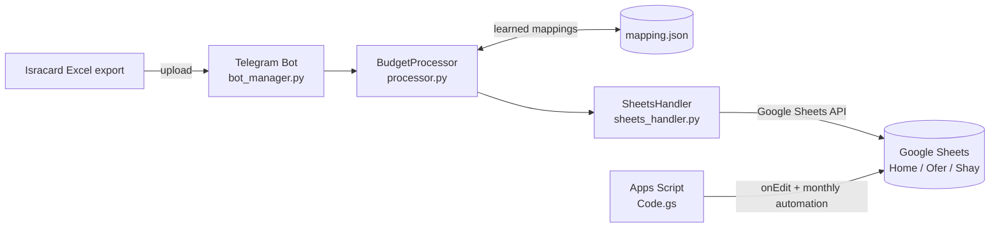

# Financial Tracker 📊

> A shared household budget system. A **Python Telegram bot** imports credit-card transactions into **Google Sheets**, and **Google Apps Script** keeps the spreadsheet organized, numbered and summarized every month.


---

## Overview

Tracking a shared budget by hand is slow: every month someone has to copy dozens of credit-card transactions into a spreadsheet, decide whether each one is a **household** or a **personal** expense, give it a clean name, put it in the right category, and keep the monthly totals correct.

This project automates the whole flow:

1. You send the monthly **Isracard** Excel export to a private Telegram bot.
2. For each transaction, the bot asks which sheet it belongs to: 🏠 Home, 👤 Ofer or 👤 Shay.
3. The bot recognizes merchants it has seen before and suggests their category. It **learns** new merchants from your answers.
4. Transactions are written into the correct month block in Google Sheets. Duplicates are skipped, and new rows are inserted when a block is full.
5. Inside the spreadsheet, Apps Script numbers the rows, adds dates, creates the next month from templates, and splits shared home costs between the personal sheets.

## Architecture



| Layer | Responsibility |
|-------|----------------|
| `src/main.py` | Entry point. Receives the file and orchestrates the per-transaction flow |
| `src/services/bot_manager.py` | Telegram UI: inline keyboards, prompts, authorization |
| `src/services/processor.py` | Excel parsing, merchant mapping and learning, month resolution |
| `src/core/sheets_handler.py` | Google Sheets API: read snapshots, find rows, insert, write, detect duplicates |
| `apps_script/Code.gs` | In-sheet automation: numbering, dates, monthly templates, formulas |

## Features

### Telegram bot (Python)
- **In-memory file processing:** the Excel file is read straight from Telegram into a `BytesIO` stream and never saved to disk.
- **Interactive classification:** inline buttons choose the target sheet and category for each transaction.
- **Self-learning merchant mapping:** new merchants get a display name and category once, and they are recognized automatically after that.
- **Duplicate detection:** a transaction is skipped if a matching description with a close amount already exists in that month.
- **Smart row placement:** finds the next free row inside the month block and inserts a new row when the block is full.
- **Access control:** only whitelisted Telegram user IDs can use the bot.

### Spreadsheet automation (Apps Script)
- **Auto-numbering:** sequential IDs per category, merged cells included.
- **Auto-date:** adds the current date when an amount is entered.
- **Monthly templates:** one run creates the new month for the Home, Ofer and Shay sheets and hides older months.
- **Formula injection:** builds the monthly totals and links fixed home expenses (rent, electricity, water, gas, property tax) to each personal sheet at a 50/50 split.
- **Clean deletes:** clearing a row resets its number and date and protects the category labels.

## Tech stack

- **Python 3.14:** pandas, openpyxl, pyTelegramBotAPI, google-api-python-client, google-auth, python-dotenv
- **Google Apps Script** (JavaScript, V8 runtime)
- **Google Sheets API v4** with a service account

## Project structure

```
Financial-Tracker/
├── apps_script/
│   └── Code.gs                 # Google Apps Script bound to the spreadsheet
├── config/
│   └── mapping.example.json    # Example of the learned merchant mapping
├── imports/                    # Local Excel exports (git-ignored)
├── logs/                       # Runtime logs (git-ignored)
├── src/
│   ├── config.py               # Paths, env vars, users, sheet constants
│   ├── main.py                 # Bot entry point and integration flow
│   ├── test_system.py          # Manual end-to-end check of the bot buttons
│   ├── core/
│   │   └── sheets_handler.py
│   ├── services/
│   │   ├── bot_manager.py
│   │   └── processor.py
│   └── utils/
│       └── constants.py
├── .env.example
├── requirements.txt
└── LICENSE
```

## Getting started

### Prerequisites
- Python 3.14
- A Google Cloud project with the **Google Sheets API** enabled and a **service account** key (JSON)
- A Telegram bot token from [@BotFather](https://t.me/BotFather)
- A Google Sheet with the tabs `בית`, `עופר`, `שי` and their templates (`שבלונה בית`, `שבלונה עופר`, `שבלונה שי`)

### 1. Install

```bash
git clone https://github.com/OferShulami/Financial-Tracker.git
cd Financial-Tracker
python3 -m venv .venv
source .venv/bin/activate
pip install -r requirements.txt
```

### 2. Configure
1. Save the service-account key as `config/service_account.json`, then share the spreadsheet with the service account's email address.
2. Copy `.env.example` to `src/.env` and fill in your spreadsheet ID, bot token and Telegram user IDs.
3. Optional: copy `config/mapping.example.json` to `config/mapping.json`. If the file is missing, the bot starts with an empty mapping.

### 3. Install the Apps Script
1. In the Google Sheet, open **Extensions → Apps Script**.
2. Paste the contents of `apps_script/Code.gs` and save.
3. `onEdit` runs automatically as a simple trigger.
4. Run `runMonthlyAutomation` manually, from a button, or with a monthly time-driven trigger.

## Usage

```bash
python src/main.py
```

Send your Isracard `.xlsx` export to the bot in Telegram and answer its prompts for each transaction.

## Roadmap
- [ ] Automated unit tests (pytest) for parsing and row-placement logic
- [ ] Support for more card issuers and bank formats
- [ ] Replace debug `print` calls with structured logging
- [ ] Containerized deployment (Docker) for always-on hosting

## License

Released under the [MIT License](LICENSE).
